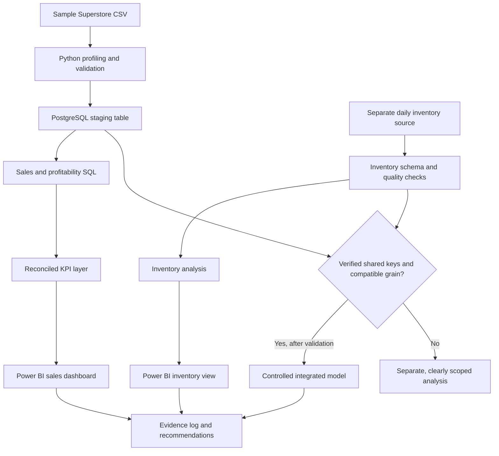

# Solution architecture

## High-level workflow

## Design decisions

1. **Profile before modelling.** Establish the grain, field meanings, date coverage and data quality before writing joins or KPI measures.
2. **Keep raw data separate.** Source files remain unchanged and are not committed unless redistribution rights are confirmed.
3. **Separate sales and inventory initially.** The supplied Superstore CSV does not contain store IDs or inventory snapshots. The second dataset must be independently validated.
4. **Use a staging layer.** Preserve source-level fields and types in PostgreSQL before creating cleaned or analytical tables.
5. **Centralise metric definitions.** Python, SQL, Excel and Power BI must use the same grain, filters and denominator.
6. **Reconcile before publishing.** Dashboard totals must tie back to validated SQL and Python outputs.
7. **Trace recommendations to evidence.** Every published action must link to a finding, its supporting output and its limitations.

## Current implementation

- Repository documentation and source register: created.
- Initial Superstore profiling notebook: created; local rerun pending.
- PostgreSQL staging DDL and sales analysis queries: created; database execution and reconciliation pending.
- Inventory workflow: design only; source inspection pending.
- Power BI model and report: planned; not yet built.
